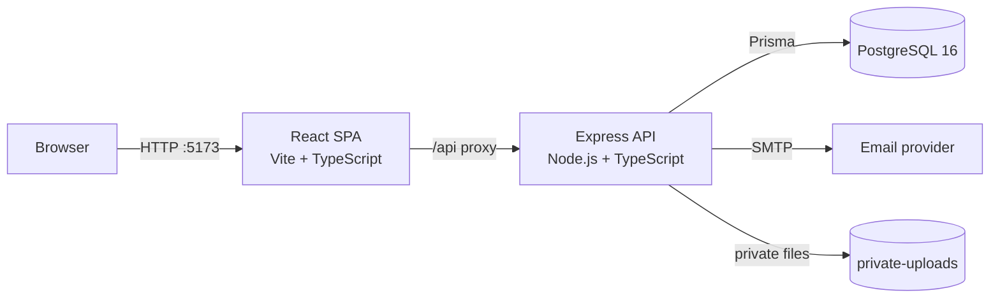

# MEKAKEL — System Architecture

## 1. Overview

MEKAKEL is a three-tier web application composed of a React single-page frontend, an Express REST API, and a PostgreSQL database. It is packaged with Docker Compose for reproducible local development and straightforward deployment.



## 2. Technology Stack

| Layer | Technologies |
| --- | --- |
| Frontend | React 19, TypeScript, Vite 8, React Router 7, Tailwind CSS 4, custom CSS |
| Backend | Node.js, Express 5, TypeScript, Zod, JWT, bcrypt, multer, nodemailer |
| Data | PostgreSQL 16, Prisma 7, `@prisma/adapter-pg` |
| Testing | Jest, Supertest, Playwright |
| Tooling | Docker, Docker Compose, ESLint, TypeScript build |
| External | SMTP, simulated Fayda identity verification |

## 3. Repository Layout

```text
mekakel/
├── backend/
│   ├── prisma/
│   │   ├── schema.prisma
│   │   └── migrations/
│   ├── scripts/
│   ├── src/
│   │   ├── controllers/      # Request handlers
│   │   ├── jobs/             # Background jobs
│   │   ├── lib/              # Prisma client, errors, shared helpers
│   │   ├── middleware/       # Auth, authorization, uploads
│   │   ├── routes/           # Express routers
│   │   ├── services/         # Business logic
│   │   ├── validators/       # Zod schemas
│   │   ├── app.ts            # App setup and route mounting
│   │   └── server.ts         # Startup, DB connect, jobs
│   ├── tests/
│   ├── Dockerfile
│   └── package.json
├── frontend/
│   ├── public/
│   ├── src/
│   │   ├── components/       # Reusable UI and feature components
│   │   ├── context/          # Auth context
│   │   ├── hooks/
│   │   ├── pages/            # Route-level screens
│   │   ├── routes/           # ProtectedRoute
│   │   ├── services/         # API clients
│   │   ├── utils/
│   │   ├── App.tsx
│   │   └── index.css
│   ├── Dockerfile
│   └── package.json
├── docs/
├── docker-compose.yml
└── README.md
```

## 4. Frontend Architecture

### 4.1 Rendering and Routing

- The frontend is a client-side SPA built with Vite and React.
- `App.tsx` defines public routes, donor routes, hospital routes, admin routes, and doctor routes.
- `ProtectedRoute` guards routes by authentication, account type, or allowed roles.
- Unknown routes redirect to the home page.
- The navbar and footer wrap all pages.

### 4.2 State and Data Access

- `AuthProvider` stores authentication state and exposes login, logout, and user data through `useAuth`.
- API calls are centralized in `src/services/*.service.ts`.
- `services/api.ts` builds requests against `VITE_API_URL` or the relative `/api` path and attaches the bearer token.
- In development, Vite proxies `/api` to the backend. The proxy target is configurable via `API_PROXY_TARGET` for Docker.

### 4.3 Components

- Layout: `navbar.tsx`, `footer.tsx`.
- Donor: `profile-form.tsx`, `availability-form.tsx`, `verification-status.tsx`.
- Inventory: `blood-unit-form.tsx`, `blood-unit-table.tsx`, `expiry-alerts.tsx`.
- Requests: `request-form.tsx`, `match-results.tsx`.
- Pages are grouped by feature: `dashboard`, `donor`, `hospital`, `admin`, `doctor`, `requests`, `reservations`, `transfers`, `notifications`.

### 4.4 Styling

- Design tokens are defined in `src/index.css` with CSS custom properties.
- Tailwind CSS is installed, while much of the interface uses semantic class names.
- Responsive breakpoints are defined at `768px` and `560px`.

## 5. Backend Architecture

### 5.1 Layered Structure

| Layer | Responsibility |
| --- | --- |
| Routes | URL mapping, middleware composition, endpoint wiring |
| Controllers | Parse request context, call services, format responses |
| Services | Business rules, transactions, domain decisions |
| Validators | Zod input validation |
| Middleware | Authentication, authorization, rate limiting, uploads |
| Prisma | Persistence and relational queries |

### 5.2 Request Pipeline

```text
Request
  → CORS
  → JSON body parser
  → Route
  → Rate limiter (where configured)
  → authenticateToken (where required)
  → requireRole / account checks
  → Validator
  → Controller
  → Service
  → Prisma
  → JSON response / error handler
```

### 5.3 API Modules

Mounted under `/api`:

- `/auth` — registration, login, password reset, token revocation.
- `/users` — current user profile.
- `/fayda` — simulated identity verification.
- `/donor` — profile, availability, eligibility, reports, history.
- `/hospital` — profile, search, donors, staff, requests.
- `/inventory` — blood units, summaries, expiry alerts.
- `/requests` — blood request lifecycle.
- `/matching` — compatible units and donors.
- `/reservations` — reservation lifecycle.
- `/transfers` — transfer lifecycle.
- `/notifications` — in-app notifications and preferences.
- `/doctor` — verification queue and medical report decisions.
- `/admin` — users, hospitals, audit logs, settings.

### 5.4 Error Handling

- Services throw typed errors from `lib/errors.ts`.
- Controllers translate domain errors into appropriate HTTP status codes.
- The API returns JSON messages suitable for display in the frontend.

## 6. Data Architecture

### 6.1 Identity and Profiles

- `User` is the authentication root.
- A user may have exactly one `DonorProfile`, `HospitalProfile`, or `DoctorProfile`.
- Hospital staff are represented by `HospitalStaffMember`, linking a user to a hospital and a staff role.

### 6.2 Blood Resources

- `BloodUnit` belongs to a hospital and stores type, component, dates, screening, confirmation, and status.
- `BloodRequest` belongs to a hospital and records the requested component, type, units, urgency, and status.
- `Reservation` links a hospital to a unit and/or donor, with an expiry and lifecycle timestamps.
- `Transfer` links one blood unit and two hospitals, with an event history in `TransferEvent`.

### 6.3 Supporting Entities

- `MedicalReport` stores donor report metadata and private file references.
- `DonationRecord` stores donation history.
- `Notification` and `NotificationPreference` support messaging.
- `AuditLog` records sensitive actions.
- `SystemSetting` stores configurable values such as eligibility and compatibility settings.
- `PasswordResetToken`, `RevokedToken`, and `RateLimitCounter` support security.

### 6.4 Indexing

Indexes cover common access paths:

- Hospital ownership of units and requests.
- Blood type, component, status, and expiry.
- Reservation status and expiry.
- Notification status, schedule, and read state.
- Audit action, actor, entity, and timestamp.

## 7. Core Flows

### 7.1 Registration and Verification

1. User registers as donor, hospital, or doctor.
2. Backend validates input and hashes the password.
3. A profile is created with a pending verification status where applicable.
4. Donors may submit Fayda identity data and medical reports.
5. Doctors review donor reports; admins review hospital registration.
6. Approval activates the relevant capabilities and creates notifications.

### 7.2 Blood Request to Reservation

1. An approved hospital creates a blood request.
2. The matching service filters compatible units and donors.
3. Units are ranked by FEFO; donors are ranked by eligibility and proximity.
4. The hospital selects a unit or donor and creates a reservation.
5. The reservation holds the unit/donor until confirmation, cancellation, or expiry.
6. A background job expires overdue reservations and releases resources.

### 7.3 Transfer Lifecycle

```text
REQUESTED → APPROVED → DISPATCHED → RECEIVED → COMPLETED
        ↘ REJECTED
        ↘ CANCELLED
```

Each transition records a `TransferEvent`, updates the blood unit state where relevant, and queues notifications for both hospitals.

### 7.4 Notifications

1. Domain services create notification records with type, category, recipient, and optional dedupe key.
2. A background job picks pending notifications.
3. Email is sent through SMTP according to user preferences.
4. Success sets status to sent; failures increment attempts and are retried up to the maximum.

### 7.5 Authentication and Sessions

1. Login validates credentials and issues a signed JWT.
2. The frontend stores the token and attaches it to API requests.
3. The backend validates the token and checks revocation.
4. Password reset increments the password version, invalidating older tokens.

## 8. Security Architecture

- Password hashing with bcrypt.
- JWT-based authentication with revocation support.
- Role- and account-type authorization middleware.
- Zod schema validation for request payloads.
- CORS restricted to configured origins.
- Rate limiting for login and sensitive endpoints.
- Private medical uploads served only through authorized endpoints.
- Audit logging for verification, inventory, reservation, transfer, role, and settings actions.
- Secrets and database credentials supplied through environment variables.

## 9. Background Jobs

| Job | Purpose | Interval |
| --- | --- | --- |
| Expire reservations | Expire due reservations and overdue blood units | 60 seconds |
| Send notifications | Deliver pending email notifications and retry failures | Periodic |

Both jobs run in-process from `server.ts` and are designed not to prevent process exit.

## 10. Deployment Architecture

### 10.1 Docker Compose

`docker-compose.yml` defines:

- `db` — PostgreSQL 16 with a persistent volume and health check.
- `backend` — Node image, Prisma generation, migrations, and development server on port 3000.
- `frontend` — Node image running Vite on port 5173 with `API_PROXY_TARGET=http://backend:3000`.

Backend and frontend source directories are bind-mounted for hot reload. Dependencies are kept in named volumes.

### 10.2 Environment Configuration

Key backend variables:

- `DATABASE_URL`
- `JWT_SECRET`
- `PORT`
- `TRUST_PROXY`
- `FRONTEND_URL`
- `CORS_ORIGINS`
- `SMTP_HOST`, `SMTP_PORT`, `SMTP_USER`, `SMTP_PASSWORD`, `SMTP_FROM`

Frontend proxy target:

- `API_PROXY_TARGET`

### 10.3 Startup Sequence

1. PostgreSQL starts and becomes healthy.
2. Backend waits for the health check.
3. Backend generates the Prisma client and applies migrations.
4. Backend starts the API and background jobs.
5. Frontend starts Vite and proxies API calls to the backend.

## 11. Testing Strategy

- Unit and integration tests in `backend/tests` using Jest and Supertest.
- End-to-end tests in `frontend/tests` using Playwright.
- Recommended checks before merging: backend tests, frontend build, and targeted E2E flows.

## 12. Known Limitations and Future Work

- Fayda verification is simulated; production requires a real integration.
- Email delivery depends on external SMTP availability.
- Background jobs run in-process; a production deployment may move them to a queue/worker.
- No real-time updates; notifications require refresh or polling.
- No SMS channel.
- Compatibility logic is advisory and must remain subordinate to clinical review.
- Future work: real-time notifications, richer analytics, audit export, and multi-facility tenancy.
