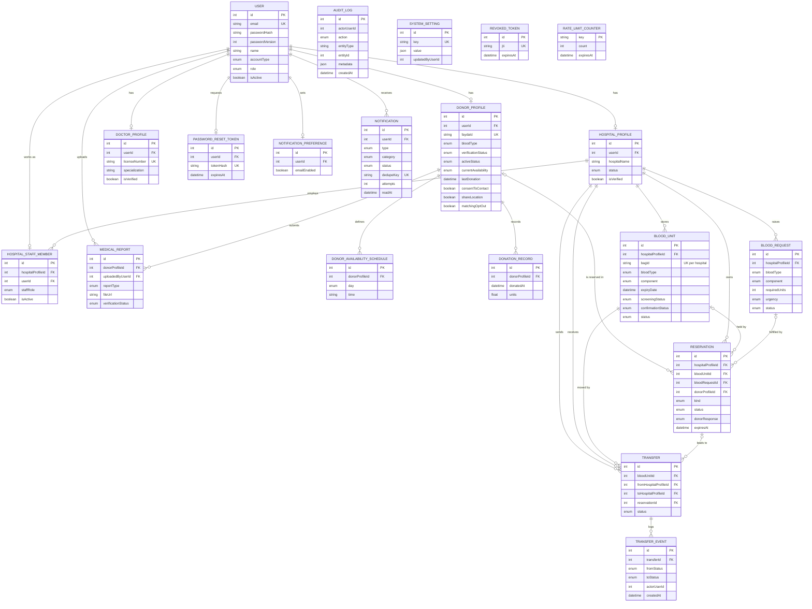

# MEKAKEL — Entity Relationship Diagram

Source: `backend/prisma/schema.prisma` (PostgreSQL, Prisma). 20 models.
PK = primary key, FK = foreign key, UK = unique. Only key columns are shown; see the Database Design document for every column.

## 1. Full ERD

## 2. Relationship summary

| Parent | Child | Cardinality | On delete |
|---|---|---|---|
| User | DonorProfile, HospitalProfile, DoctorProfile, HospitalStaffMember | 1 to 0..1 | Cascade |
| User | PasswordResetToken, NotificationPreference | 1 to 0..1 | Cascade |
| User | Notification | 1 to many | Cascade |
| User | MedicalReport (uploader) | 1 to many | Cascade |
| DonorProfile | DonorAvailabilitySchedule, MedicalReport, DonationRecord | 1 to many | Cascade |
| DonorProfile | Reservation | 1 to many (optional) | Set null |
| HospitalProfile | HospitalStaffMember, BloodUnit, BloodRequest, Reservation | 1 to many | Cascade |
| HospitalProfile | Transfer (sender and receiver) | 1 to many, twice | Cascade |
| BloodUnit | Reservation | 1 to many (optional) | Cascade |
| BloodUnit | Transfer | 1 to many | Cascade |
| BloodRequest | Reservation | 1 to many (optional) | Set null |
| Reservation | Transfer | 1 to many (optional) | Set null |
| Transfer | TransferEvent | 1 to many | Cascade |

## 3. Notes

- **No foreign key, by design:** `AuditLog`, `SystemSetting`, `RevokedToken` and `RateLimitCounter` stand alone. Actor ids on `AuditLog`, `SystemSetting`, `TransferEvent` and `BloodRequest.createdByUserId` are plain integers, so history survives user deletion.
- **Reservation target:** a reservation points to either a blood unit or a donor, depending on `kind` (`BLOOD_UNIT` or `DONOR`).
- **Unique rules:** one profile per user per role, one availability slot per donor per weekday, and one bag ID per hospital.
